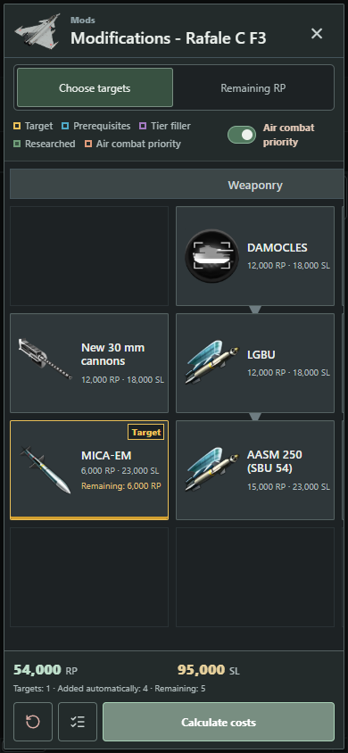

  

<h1 align="center">War Thunder Research Calculator</h1>

Choose your targets. Map your route. Know the RP and Silver Lions you need.

  <a href="https://plastic-time.github.io/warthunder-research-calculator/"><strong>Open Web App</strong></a> &nbsp; · &nbsp;
  <a href="https://github.com/Plastic-time/warthunder-research-calculator/releases/latest"><strong>Download for Windows</strong></a> &nbsp; · &nbsp;
  <a href="doc/web-updates.md#english">Changelog</a>

<strong>English</strong> &nbsp; / &nbsp; <a href="README.zh-CN.md">简体中文</a>

3,238 vehicles · 3,228 modification trees · 5 vehicle categories · 7 UI languages

## Plan Your Research Route

**More than adding up prices.** Set your targets and mark the vehicles you own. The calculator searches for a low-RP route that meets prerequisites and rank unlock requirements. Then it totals the RP and Silver Lions you need.

- **See why each vehicle is selected**: targets, waypoints, required vehicles and rank fillers are marked differently. Folders show how many of their vehicles are selected. Once you set a target, vehicles and links off the route are dimmed. Hover over them to bring them back.
- **Adjust the result**: remove one vehicle or mark it as owned without clearing the rest of the route. The route is recalculated only when you run the planner again.
- **Enter the remaining RP shown in the game**: if a 140,000 RP vehicle still needs 60,000, enter 60,000. The budget and the planner use that amount. The Silver Lion cost stays the same.
- **Mark whole ranks as owned**: mark regular vehicles at a chosen rank and below. Review the list before you confirm, and undo it if needed. Special and hidden vehicles are left out.
- **Keep the budget in view**: the bottom bar shows how many vehicles are left to research, plus their RP and Silver Lions. On desktop it also counts your targets and waypoints. You can export the full tech tree with its budget as an image.

> Route optimization is in beta. If the search hits the computation limit on your device, it returns the best route found so far. A cheaper route may still exist. Check the route in the game before you research.

## Build Your Modification Plan

**Research only the modifications you need.** Open a vehicle's modification window. Pick targets by category, tier and prerequisite, and mark what you have already researched. The calculator fills in everything else that is required.

- **Choose freely**: select one modification or several. RP, Silver Lions and tier counts update as you go.
- **Fill in the requirements**: select Calculate costs to add prerequisites and tier fillers. Researched items are not charged again.
- **Enter remaining RP**: switch to Remaining RP, select a modification and enter the amount shown in the game. Enter 0 when no RP is left. Enter the full cost to clear that record. Progress saved by earlier versions is converted automatically, so you don't need to enter it again.
- **Air combat priority**: on by default, and you can turn it off. It favors countermeasures and air combat modifications. Air-to-air missiles still follow your chosen targets and their actual prerequisites.
- **Clear and undo**: the curved-arrow button at the bottom clears this vehicle's targets, researched marks and progress. It keeps the Air combat priority setting and leaves other vehicles alone. You can undo for 15 seconds. Another change, closing the window or switching vehicles removes the undo option.
- **Separate budget**: modification costs are not added to the vehicle research total. Modifications priced at exactly 0 RP and 0 SL show as Unlocked.

View the mobile modification window

## Get Started

Open the [web app](https://plastic-time.github.io/warthunder-research-calculator/) in your browser. No installation or game account is needed.

On Windows, you can download the [v1.0.32 portable package](https://github.com/Plastic-time/warthunder-research-calculator/releases/download/v1.0.32/WarThunderResearchCalculator-v1.0.32-portable.zip). Extract it and run `WarThunderResearchCalculator.exe`. Node.js and .NET are bundled, so you don't need to install them.

> v1.0.32 adds nine aircraft, including the F-15EX. It also corrects F-5E and JAS39A modifications and fixes live-version detection in the update checker. It bundles the Node.js 24.22.3 and .NET 10.0.15 security updates. The download does not receive later web updates. Screenshots are for illustration only.

### Controls

| Action | Desktop | Mobile |
| --- | --- | --- |
| Select or deselect a target | Left-click | Tap |
| Mark as owned, set a waypoint, and more | Right-click to open the menu | Press and hold for about half a second |
| Enter a vehicle's remaining RP | Right-click → Research progress | Press and hold → Research progress |
| Plan a route | Select Optimize route in the bottom bar | Same |
| Read about a vehicle | Select the Wiki bookmark on its card | Same |
| Open modifications | Select the gear at the top right of the card | Same |

### Layout

On desktop, the header is one row: nation, search, and icon buttons for Filters, Guide, Export, Clear plan and Backup. Hover over an icon to see its name.

- Filters holds Calculation scope, Avoid foldered vehicles for rank fillers, and Select all.
- Language and game version are under More at the top right.
- Select the avatar to see author details.
- In a narrow window, nation and category share one row. Search moves to the next row.

On mobile, the guide and export are under More at the top. Search and filters have their own buttons.

### Search

Search accepts F15, F-15 or F 15 and shows how many vehicles match. On mobile, View results jumps to the first match, even inside a folder. Clear search takes you back to where you were in the tree. Your plan and RP progress are kept.

### Manage Your Plan

- **Select all** (in Filters): selects or deselects every regular research vehicle in the current nation and category, folders included. Owned marks and research progress are kept.
- **Clear plan**: removes selections, status marks and vehicle research progress for the current nation and category. Undo within 15 seconds to restore them and the previous route. The undo expires once you make another change or switch trees. Other trees are not affected.
- **Remaining RP of 0**: this does not mark a vehicle as owned or a modification as researched. Set those separately. Progress never reduces the Silver Lion purchase cost. Enter a whole number from 0 to the full cost. The field cannot be left blank.
- **Exported images**: they show the tree's original totals and the RP and Silver Lions your selection still needs. Missing costs are flagged separately.
- **Backup and restore**: on desktop, select the backup icon at the top right. On mobile, open More → Backup and restore. Export a JSON file with targets, owned marks, waypoints, RP progress and modification records for every tree in this browser. Before an import, you see how many records the file has and how many it will overwrite. Only records in the file are replaced. Other plans stay as they are. Files are processed on your device and never uploaded. This is a manual transfer, not automatic sync.

### Vehicles and Languages

Ground vehicles, aircraft, helicopters, bluewater fleets and coastal fleets are all covered. The interface and vehicle names are available in Chinese, English, Russian, German, French, Japanese and Spanish. This project does not translate third-party Wiki articles.

Recent web changes are in the [web changelog](doc/web-updates.md#english). The in-app guide keeps notes for earlier releases.

## Data and Limitations

- **Fixed snapshot**: vehicle costs are based on game version **2.59.0.17** and do not update live with the game. Future cost and prerequisite checks use game configuration as the primary source. The Wiki only supplements names, images and layout. Some existing importers still use older sources, so the data is not yet sourced entirely from game configuration.
- **Protected tree refreshes**: a Wiki refresh only updates names, images and role descriptions of existing entries. Costs, prerequisites, ranks, folders and source records stay unchanged. New, missing or conflicting entries go into a review report and never overwrite confirmed data. A refresh is not a review of a new game version.
- **Scoped corrections**: each is recorded separately. None of them is a full snapshot upgrade.
  - Ka-29 and Do 217 J-2: confirmed corrections are kept.
  - Both CA-27 variants: v1.0.11 set GLBC mk.3 to **9,000 RP / 14,000 SL** from the **2.59.0.34** configuration.
  - F4U-7: v1.0.19 updated modification costs, the cannon upgrade tier and unlock counts from **2.59.0.38**. All its modifications total **47,800 RP / 86,900 SL**.
  - Greek F-86E(M), MiG-23M and Object 416: v1.0.25 updated their modifications from **2.59.0.50**. See the [release notes](doc/release-v1.0.25.md#english) for cost and prerequisite changes.
- **Latest reviewed version**: **2.61.0.9**. Added nine aircraft with their research costs, prerequisites and 181 modification nodes, including the F-15EX, F-15IA, Su-15TM and three premium pack aircraft. Saved plans are kept. This is a partial update, not a full snapshot upgrade.
- **Data updates in the v1.0.32 package**:
  - [BR update for 638 vehicles](doc/battle-rating-update-20261029.md) (Chinese)
  - [Mode-specific BR correction for seven aircraft](doc/battle-rating-correction-20261030.md), game version 2.59.0.94 (Chinese)
  - [Vehicle cost update for three Japanese aircraft](doc/vehicle-cost-update-20261029.md) (Chinese)
  - [Modification update for six vehicles](doc/modification-update-20261029.md)
- **Event vehicles**: evidence for earlier [event vehicles](doc/game-roster-additions-20261024.md) and [event modifications](doc/event-modifications-20261024.md) is kept.
- **Unknown is not free**: a missing price shows as Not provided, never as zero. Rank unlock counts still come from the project's own rules table. Check every plan in the game.
- **Plans stay in your browser**: selections, routes and RP progress are saved in this browser. They are not uploaded or synced across devices. Clearing the site's data deletes them. Images, Wiki pages and the online counter need a connection. The counter is an estimate of active browsers. If it goes down, calculations still work.

Development, maintenance, and further reading

- [Local setup and data maintenance](doc/development.md) (Chinese)
- [Server configuration and update permissions](doc/server-security.md)
- [Online counter rules](doc/online-counter.md) (Chinese)
- [Modification artwork sources](doc/ammunition-artwork.md) (Chinese)
- [Vehicle snapshot manifest](docs/database/manifest.json) · [Modification audit](tools/modifications-audit.json)
- [v1.0.32 notes](doc/release-v1.0.32.md) · [All releases](https://github.com/Plastic-time/warthunder-research-calculator/releases)

---

An unofficial, player-made tool. Not affiliated with Gaijin Entertainment. Game names, vehicle images, and other third-party assets belong to their respective owners.

 &nbsp; bilibili: <a href="https://space.bilibili.com/543495611">扑街的靓仔</a> &nbsp; · &nbsp; In-game ID: 如日方中

