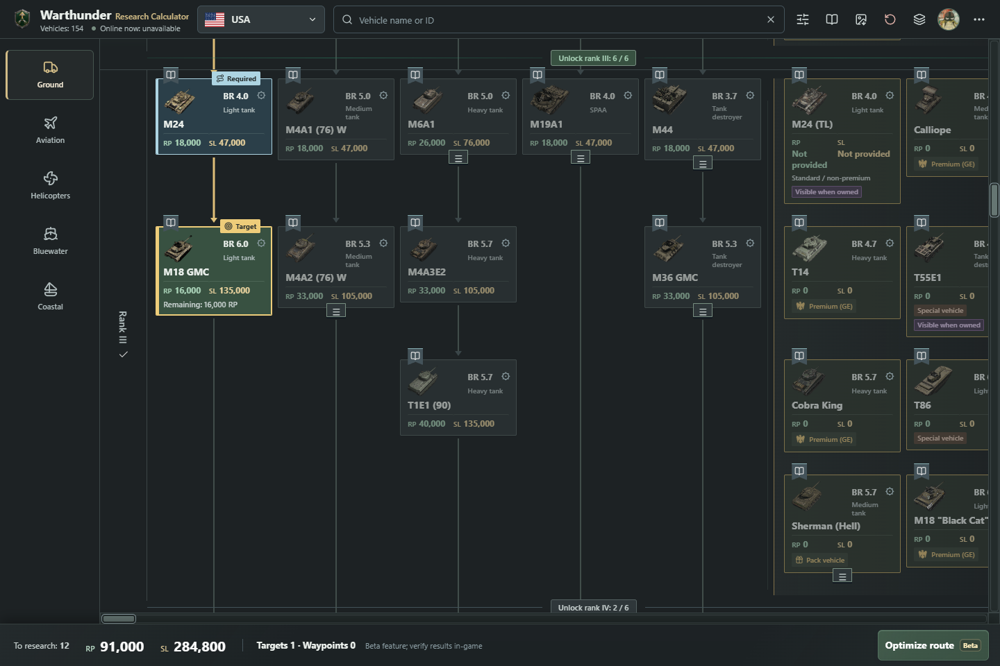
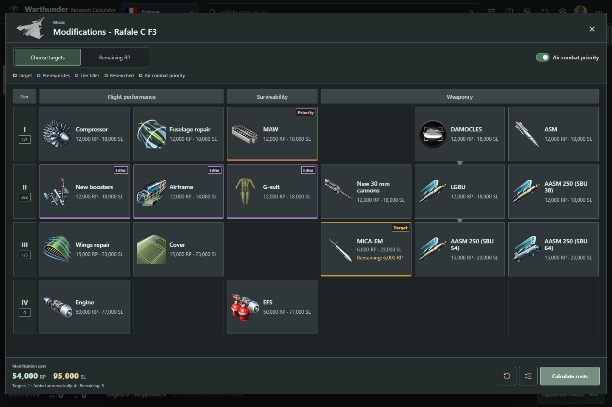

  

<h1 align="center">War Thunder Research Calculator</h1>

Pick the vehicles and modifications you want. Map the route and total your RP and Silver Lions.

  <a href="https://plastic-time.github.io/warthunder-research-calculator/"><strong>Open Web App</strong></a> &nbsp; · &nbsp;
  <a href="https://github.com/Plastic-time/warthunder-research-calculator/releases/latest"><strong>Download for Windows</strong></a> &nbsp; · &nbsp;
  <a href="doc/web-updates.md#english">Changelog</a>

<strong>English</strong> &nbsp; / &nbsp; <a href="README.zh-CN.md">简体中文</a>

3,278 vehicles · 3,268 modification trees · 5 vehicle categories · 7 UI languages

## Quick Start

Open the [web app](https://plastic-time.github.io/warthunder-research-calculator/) in your browser. No install, no game login.

Prefer to run it locally on Windows? Download the [v1.0.32 portable package](https://github.com/Plastic-time/warthunder-research-calculator/releases/download/v1.0.32/WarThunderResearchCalculator-v1.0.32-portable.zip), extract it, and run `WarThunderResearchCalculator.exe`. Node.js 24.22.3 and .NET 10.0.15 security updates are bundled, with nothing else to install.

Covers ground vehicles, aircraft, helicopters, bluewater fleets, and coastal fleets. Interface and vehicle names are available in Chinese, English, Russian, German, French, Japanese, and Spanish. Third-party Wiki articles are not translated by this project.

> v1.0.32 adds nine aircraft including the F-15EX, corrects F-5E and JAS39A modifications, and fixes live-version detection in the update checker. The portable download does not receive later web updates—see the [web changelog](doc/web-updates.md#english) for recent changes. Screenshots are for illustration only.

## Plan Your Tech Tree Route

Starting a new line is never just adding up vehicle prices. You have to trace prerequisites, hit rank unlock counts, and account for vehicles you already own or partly researched. Pick your targets and mark what you own. The calculator finds a low-RP route that meets every requirement and totals the RP and Silver Lions you need.

- **See why each vehicle is on the route**: targets, waypoints, required vehicles, and rank fillers are styled differently. Folders show how many of their vehicles are selected. Once a target is set, vehicles and links off the route dim until you hover over them.
- **Enter the remaining RP shown in-game**: if a 140,000 RP vehicle has 60,000 left, type 60,000. Both the budget and the route planner use that number. Silver Lion costs stay unchanged.
- **Mark whole ranks as owned**: check off regular vehicles at a chosen rank and below in one step. Special and hidden vehicles are skipped. You can review the list before confirming and undo afterward.
- **Tweak the route after planning**: removing a vehicle or marking it owned will not wipe the rest of your route. The planner only recalculates when you run it again.
- **Live budget and full-tree export**: the bottom bar tracks remaining vehicles, RP, and Silver Lions, plus target and waypoint counts on desktop. You can export the full tech tree as an image showing both the tree's original totals and your remaining budget, with missing prices flagged separately.

> Route optimization is in beta. If the search hits your device's computation limit, it returns the best route found so far; a cheaper route may still exist. Check the route in-game before you start researching.

## Plan Vehicle Modifications

Want to unlock specific shells, missiles, or countermeasures without spading the whole vehicle? Open a vehicle's modification window, pick your targets, mark what you have already researched, and click **Calculate costs** to fill in prerequisites and tier requirements.

- **Pick freely, budgeted separately**: select one modification or several and watch RP, Silver Lions, and tier counts update live. Researched items are never charged again, and items priced at exactly 0 RP and 0 SL appear as **Unlocked**. Modification costs stay separate from the vehicle research total.
- **Track remaining RP**: switch to **Remaining RP** and click any modification to enter what the game shows. Enter `0` when no RP is left, or enter the full cost to clear that entry. Progress saved by older versions converts automatically.
- **Air combat priority**: on by default and easy to toggle off. When enabled, tier fillers favor countermeasures and air combat upgrades. Air-to-air missiles still follow your targets and real prerequisites.
- **One-click clear with undo**: the curved-arrow button at the bottom clears this vehicle's targets, researched marks, and RP progress while keeping your Air combat priority toggle and leaving other vehicles untouched. You have 15 seconds to undo; another edit, closing the window, or switching vehicles dismisses the undo bar.

View the mobile modification window

## Controls & Tips

| Action | Desktop | Mobile |
| --- | --- | --- |
| Select or deselect a target | Left-click | Tap |
| Mark as owned, set a waypoint, and more | Right-click to open the menu | Press and hold (~0.5 s) |
| Enter a vehicle's remaining RP | Right-click → Research progress | Press and hold → Research progress |
| Plan a route | Click **Optimize route** in the bottom bar | Same |
| Read about a vehicle | Click the Wiki bookmark on its card | Same |
| Open modifications | Click the gear at the top right of the card | Same |

- **Flexible search**: matches `F15`, `F-15`, and `F 15` alike and shows the match count. On mobile, **View results** jumps straight to the match, even inside a folder. **Clear search** returns you to where you were without touching your plan or progress.
- **Select all and Clear plan**: **Select all** lives under **Filters** and toggles every regular vehicle in the current tree (folders included) while keeping owned marks and progress. **Clear plan** wipes selections, status marks, and vehicle RP progress for the current tree only, with a 15-second undo window (cleared on your next edit or tree switch).
- **0 remaining RP is not Owned**: entering `0` does not mark a vehicle as owned or a modification as researched, and never reduces Silver Lion costs. Set completion status separately. Values must be whole numbers from `0` to the full cost and cannot be blank.
- **Backup and restore**: click the backup icon at the top right on desktop, or open **More → Backup and restore** on mobile. Export a JSON file holding targets, owned marks, waypoints, RP progress, and modification records for every tree in this browser. Before restoring, a preview shows how many records the file contains and how many will be overwritten; only matching records are replaced. Everything stays on your device—manual transfer only, not automatic sync.

Interface layout details

- On desktop, the header fits on one row: nation selector, search box, and icon buttons for **Filters**, **Guide**, **Export**, **Clear plan**, and **Backup** (hover for labels). In narrow windows, nation and category share the first row and search wraps below.
- **Filters** holds **Calculation scope**, **Avoid foldered vehicles for rank fillers**, and **Select all**. Language and game version live under **More** at the top right. Click the avatar for author details.
- On mobile, **Guide** and **Export** live under **More** at the top; search and filters have their own buttons.

## Data & Limitations

- **Fixed snapshot**: baseline vehicle costs come from game version **2.59.0.17** and do not sync live with the game. Future cost and prerequisite reviews rely on game configuration as the primary source, with the Wiki supplying names, images, and layout. Some legacy importers still draw from older sources, so the dataset is not yet 100% game-config sourced.
- **Latest reviewed version**: **2.61.0.42**. Added 31 vehicles, reviewed their acquisition and prerequisites, updated naval modification costs, and refreshed variable battle ratings. The base snapshot remains separately versioned.
- **Unknown is not free**: missing costs show as **Not provided**, never `0`. Rank unlock counts still use the project's own rules table. Verify every plan in-game before spending RP or Silver Lions.
- **Plans stay in your browser**: selections, routes, and RP progress live only in this browser. Nothing is uploaded or synced across devices, and clearing site data deletes them. Vehicle images, Wiki pages, and the online counter require a network connection. The online counter estimates active browsers; if it goes down, calculations keep working.

Data revisions and historical updates

- **Protected tree refreshes**: Wiki refreshes only update names, images, and role descriptions on existing entries. Costs, prerequisites, ranks, folders, and source records remain untouched. New, missing, or conflicting entries go to a review report instead of overwriting confirmed data. A Wiki refresh is not a new game-version review.
- **Scoped corrections** (recorded individually; none is a full snapshot upgrade):
  - Ka-29 and Do 217 J-2: confirmed corrections are kept.
  - Both CA-27 variants: v1.0.11 set GLBC mk.3 to **9,000 RP / 14,000 SL** from **2.59.0.34** ([notes](doc/release-v1.0.11.md), Chinese).
  - F4U-7: v1.0.19 updated modification costs, the cannon upgrade tier, and unlock counts from **2.59.0.38**, totaling **47,800 RP / 86,900 SL** ([notes](doc/release-v1.0.19.md#english)).
  - Greek F-86E(M), MiG-23M, and Object 416: v1.0.25 updated modifications from **2.59.0.50** ([release notes](doc/release-v1.0.25.md#english)).
- **Data updates bundled in v1.0.32**:
  - [BR update for 638 vehicles](doc/battle-rating-update-20261029.md) (Chinese)
  - [Mode-specific BR correction for seven aircraft](doc/battle-rating-correction-20261030.md), game version 2.59.0.94 (Chinese)
  - [Vehicle cost update for three Japanese aircraft](doc/vehicle-cost-update-20261029.md) (Chinese)
  - [Modification update for six vehicles](doc/modification-update-20261029.md)
- **Event vehicles**: evidence for earlier [event vehicles](doc/game-roster-additions-20261024.md) and [event modifications](doc/event-modifications-20261024.md) is retained.
- Recent web updates are listed in the [web changelog](doc/web-updates.md#english); earlier release notes remain in the in-app guide.

Development, maintenance, and further reading

- [Local setup and data maintenance](doc/development.md) (Chinese)
- [Server configuration and update permissions](doc/server-security.md)
- [Online counter rules](doc/online-counter.md) (Chinese)
- [Modification artwork sources](doc/ammunition-artwork.md) (Chinese)
- [Vehicle snapshot manifest](docs/database/manifest.json) · [Modification audit](tools/modifications-audit.json)
- [v1.0.32 notes](doc/release-v1.0.32.md) · [All releases](https://github.com/Plastic-time/warthunder-research-calculator/releases)

---

An unofficial, player-made tool. Not affiliated with Gaijin Entertainment. Game names, vehicle images, and other third-party assets belong to their respective owners.

 &nbsp; bilibili: <a href="https://space.bilibili.com/543495611">扑街的靓仔</a> &nbsp; · &nbsp; In-game ID: 如日方中

