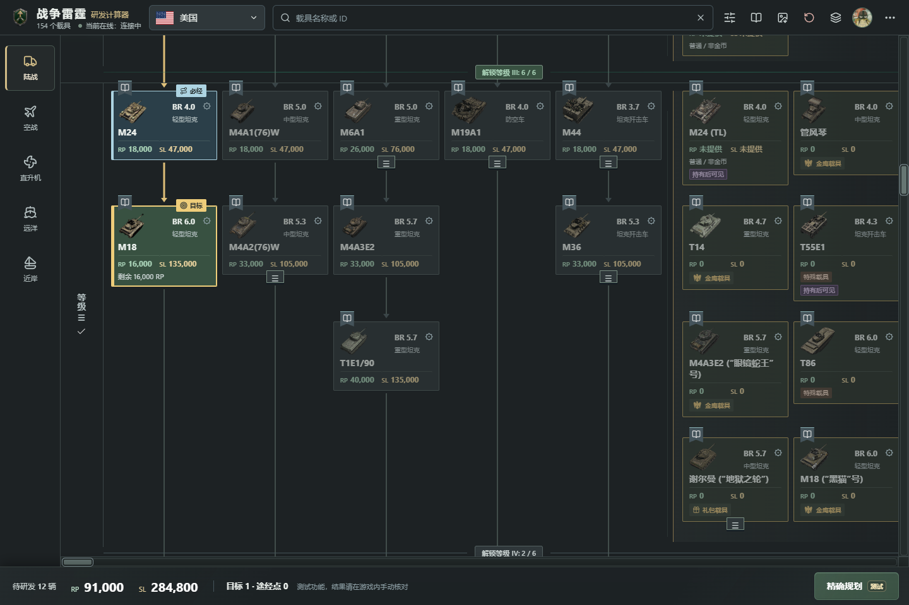
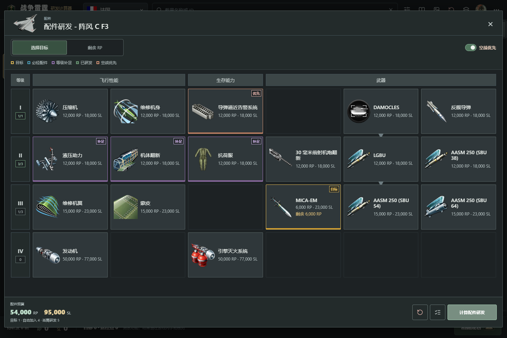
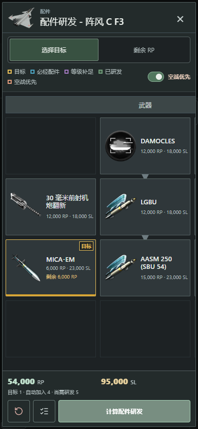

  

<h1 align="center">War Thunder 研发计算器</h1>

挑好想开的载具和配件，算清路线、研发点与银狮。

  <a href="https://plastic-time.github.io/warthunder-research-calculator/"><strong>打开网页版</strong></a> &nbsp; · &nbsp;
  <a href="https://github.com/Plastic-time/warthunder-research-calculator/releases/latest"><strong>下载 Windows 版</strong></a> &nbsp; · &nbsp;
  <a href="doc/web-updates.md">更新日志</a>

<a href="README.md">English</a> &nbsp; / &nbsp; <strong>简体中文</strong>

3,247 辆载具 · 3,237 套配件树 · 5 类军种 · 7 种界面语言

## 马上开始

浏览器直接[打开网页版](https://plastic-time.github.io/warthunder-research-calculator/)就能用，不用安装，也不用登录游戏账号。

需要离线运行的话，Windows 用户可以下载 [v1.0.32 便携包](https://github.com/Plastic-time/warthunder-research-calculator/releases/download/v1.0.32/WarThunderResearchCalculator-v1.0.32-portable.zip)，解压后运行 `WarThunderResearchCalculator.exe`。压缩包自带 Node.js 24.22.3 和 .NET 10.0.15 安全更新，不用另装运行库。

覆盖陆战、空战、直升机、远洋与近岸舰队。界面和载具名称支持中文、英语、俄语、德语、法语、日语和西班牙语，第三方 Wiki 正文不由本项目翻译。

> v1.0.32 新增 F-15EX 等九架飞机，修正 F-5E 与 JAS39A 配件，并修复更新检查对正式服版本的识别。下载包不会自动获得之后的网页更新，最新改动见[网页更新日志](doc/web-updates.md)。截图仅作界面示意。

## 规划科技树路线

开新线时，麻烦的从来不是把车价加起来，而是算前置链、凑每级解锁数量，还要绕开已经拥有或研发了一半的载具。选好目标、标上已拥有的车，计算器会按当前前置和等级门槛搜出 RP 较低的路线，把要准备的研发点和银狮一次列出来。

- **一眼分清每辆车的用途**：目标、途经点、必经载具和等级补足分别标示，折叠组会直接显示已选数量。设定目标后，路线之外的载具和连线会变暗，鼠标移上去即恢复。
- **按游戏里的剩余 RP 算**：直接填游戏显示的剩余数值。例如总计 140,000 RP、还剩 60,000 RP，就填 60,000。预算和自动规划都按这个数计算，银狮不变。
- **按等级批量标记已拥有**：一次勾选本级及以下的普通载具，特殊和隐藏载具不会一并标记。确认前能核对列表，操作后可撤销。
- **算完照样能手调**：单独取消一辆车或改标已拥有，不会清空整条路线。再次点击“精确规划”时才重新计算。
- **底栏汇总，整树导出截图**：底栏显示待研发数量、RP 和银狮，电脑端还显示目标和途经点数量。完整科技树可连同原始总额和当前所需预算导出为图片，缺失费用会单独提示。

> 精确规划为测试功能。搜索达到本机计算上限时，给出的是当前找到的最佳路线，不保证全局最优。实际研发前请在游戏内核对。

## 定制配件研发

只想先点出关键弹药、导弹或干扰，不想整车全开？打开载具配件窗口，选好目标并标出已研发的项目，点击“计算配件研发”就能自动补齐前置和等级门槛。

- **自由选配，独立结算**：选一个或多个配件，RP、银狮和各层解锁数量实时更新。已研发项不重复计费，明确为 0 RP、0 SL 的配件直接显示“已解锁”。配件费用不计入载具研发总计。
- **填写剩余 RP**：切换到“剩余 RP”模式后点选配件录入。填 0 表示不再需要 RP，填回总费用可清除记录。旧版记录会自动换算，不用重填。
- **空战优先**：默认开启，可手动关闭。开启后补等级会优先考虑干扰装置和空战配件；对空导弹仍按你选的目标和真实前置计算。
- **一次清空，可撤销**：点击底部回转箭头，可清除当前载具的配件目标、已研发标记和进度，空战优先设置保留，不影响其他载具。清空后 15 秒内可撤销；继续修改、关闭窗口或切换载具后，撤销入口消失。

查看手机配件窗口

## 常用操作

| 操作 | 电脑 | 手机 |
| --- | --- | --- |
| 选择或取消目标 | 左键点击 | 轻点 |
| 设为已拥有、途经点等 | 右键打开菜单 | 长按约半秒 |
| 填写载具剩余 RP | 右键 → 研发进度 | 长按 → 研发进度 |
| 自动计算路线 | 点击底栏“精确规划” | 同左 |
| 查看载具资料 | 点击卡片上的 Wiki 小书签 | 同左 |
| 打开配件研发 | 点击卡片右上角的齿轮 | 同左 |

- **搜索**：兼容 `F15`、`F-15`、`F 15` 等写法并显示匹配数量。手机端点“查看结果”可直接定位，折叠组里的也能找到。清除搜索后回到原位，计划和进度不变。
- **全选与清空**：“全选”在“筛选”菜单里，用于勾选或取消当前树的全部常规研发载具（含折叠载具），已拥有标记和研发进度保留。“清空计划”只清除当前科技树的选择、状态和载具进度，15 秒内可撤销（继续修改或切树后失效）。
- **剩余 RP 填 0 ≠ 已拥有**：填 0 不会自动标记已拥有或已研发，完成状态要单独标，进度也不会扣减银狮。输入须为 0 到总费用之间的整数，不能留空。
- **备份与恢复**：电脑端点右上角备份图标，手机端进“更多 → 备份与恢复”。导出的 JSON 文件包含当前浏览器所有科技树的目标、已拥有标记、途经点、RP 进度和配件记录。导入前会显示记录总数和覆盖数量，确认后只替换文件里包含的记录，其他计划保留。文件只在本地处理，不上传服务器，属于手动转移而非自动跨设备同步。

界面布局说明

- 电脑端顶栏排成一行：国家、搜索，以及筛选、使用指南、导出截图、清空计划、备份几个图标按钮，鼠标悬停可看名称。窗口较窄时，国家与军种占一行，搜索另起一行。
- “筛选”菜单包含计算范围、“自动补位时避开折叠载具”和“全选”；语言和游戏版本在右上角“更多”菜单；点击头像可查看作者信息。
- 手机版的使用指南和导出功能在顶部“更多”菜单里，搜索和筛选各有独立入口。

## 数据与边界

- **基础快照**：整体载具费用基准为游戏 **2.59.0.17**，不随游戏实时同步。后续核对费用和前置以游戏配置为主要依据，Wiki 只补充名称、图片和布局。现有导入流程仍用到部分历史来源，不能算作全部来自游戏配置。
- **最新核对版本**：**2.61.0.9**。补入 9 架新飞机的研发费用、前置关系和 181 个配件节点，包含 F-15EX、F-15IA、Su-15TM 及三款礼包机。已有计划保留，基础快照未整体升级。
- **未知不是免费**：缺失费用显示“未提供”，不当作 0。等级解锁数量沿用项目自己的规则表。规划结果请在游戏内核对。
- **计划留在浏览器**：选择、路线和研发进度只保存在当前浏览器，不上传，也不跨设备同步。清除浏览器的站点数据会删除这些记录。图片、Wiki 和在线人数需要联网；在线人数是活跃浏览器估计值，统计异常不影响计算。

数据修订与历史更新记录

- **科技树更新保护**：Wiki 刷新只更新已有条目的名称、图片和用途说明。费用、前置、等级、折叠结构和来源记录保持不变；新增、缺失或冲突条目进入核对报告，不会自动覆盖已确认数据。这一步不等于核对了新的游戏版本。
- **局部修正**（以下单独记录，均不代表整体快照升级）：
  - Ka-29、Do 217 J-2：保留已确认的修正。
  - 两架 CA-27：v1.0.11 按 **2.59.0.34** 配置，将 GLBC mk.3 改为 **9,000 RP / 14,000 SL**（[说明](doc/release-v1.0.11.md)）。
  - F4U-7：v1.0.19 按 **2.59.0.38** 更新配件费用、机炮翻新层级和解锁数量，全部配件合计 **47,800 RP / 86,900 SL**（[说明](doc/release-v1.0.19.md)）。
  - 希腊 F-86E(M)、米格-23M 和 416 工程：v1.0.25 按 **2.59.0.50** 定向更新配件，费用与前置变化见[更新说明](doc/release-v1.0.25.md)。
- **v1.0.32 便携包已包含的数据更新**：
  - [638 辆载具的 BR 更新](doc/battle-rating-update-20261029.md)
  - [七架飞机的分模式 BR 修正](doc/battle-rating-correction-20261030.md)，游戏版本 2.59.0.94
  - [三架日系飞机的载具费用更新](doc/vehicle-cost-update-20261029.md)
  - [六辆载具的配件更新](doc/modification-update-20261029.md)（英文）
- **活动载具**：此前补录的[活动载具依据](doc/game-roster-additions-20261024.md)（英文）和[活动配件依据](doc/event-modifications-20261024.md)（英文）继续保留。
- 更多网页改动见[网页更新日志](doc/web-updates.md)，使用指南里保留早期版本记录。

开发、维护与更多说明

- [本地运行与数据维护](doc/development.md)
- [服务器配置与更新权限](doc/server-security.md)（英文）
- [在线人数统计规则](doc/online-counter.md)
- [配件图标来源](doc/ammunition-artwork.md)
- [载具快照清单](docs/database/manifest.json) · [配件核对记录](tools/modifications-audit.json)
- [v1.0.32 更新说明](doc/release-v1.0.32.md) · [全部版本](https://github.com/Plastic-time/warthunder-research-calculator/releases)

---

由玩家制作的非官方工具，与 Gaijin Entertainment 无隶属关系。游戏名称、载具图片等素材的权利归各自权利人所有。

 &nbsp; bilibili：<a href="https://space.bilibili.com/543495611">扑街的靓仔</a> &nbsp; · &nbsp; 游戏 ID：如日方中

